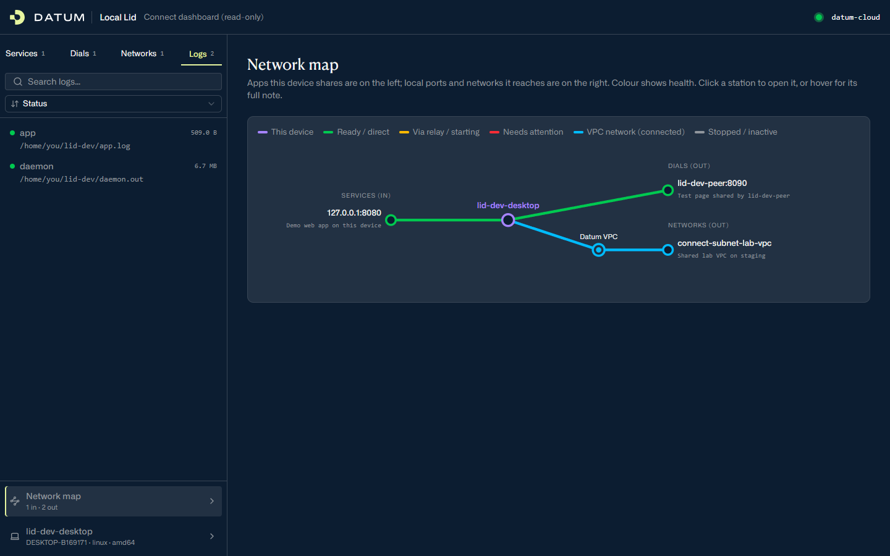
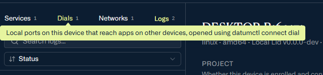
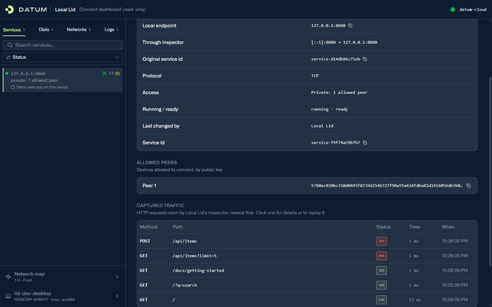
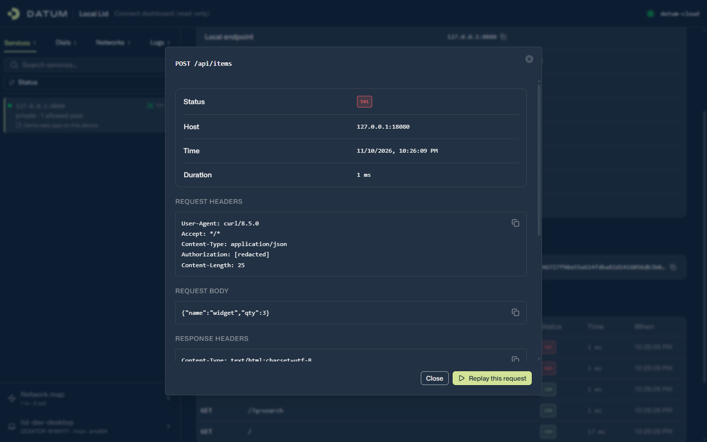
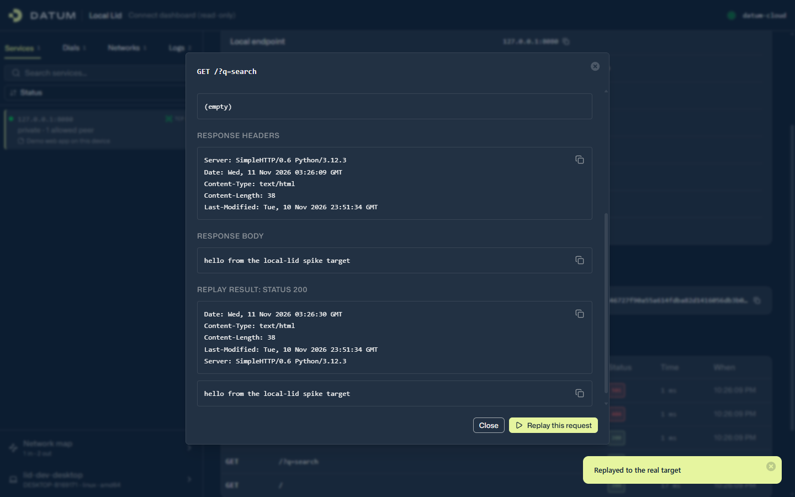
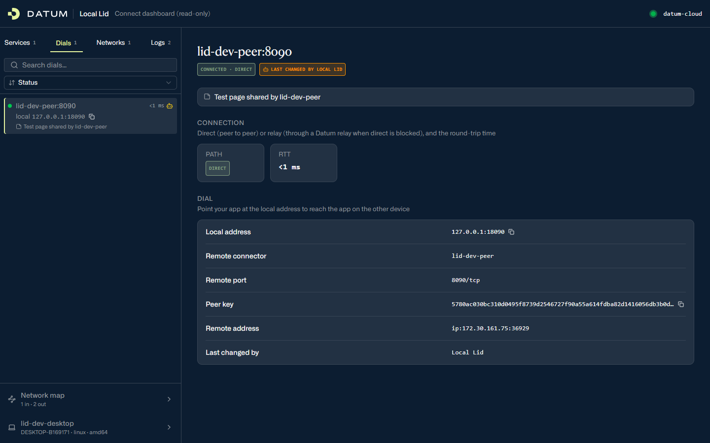
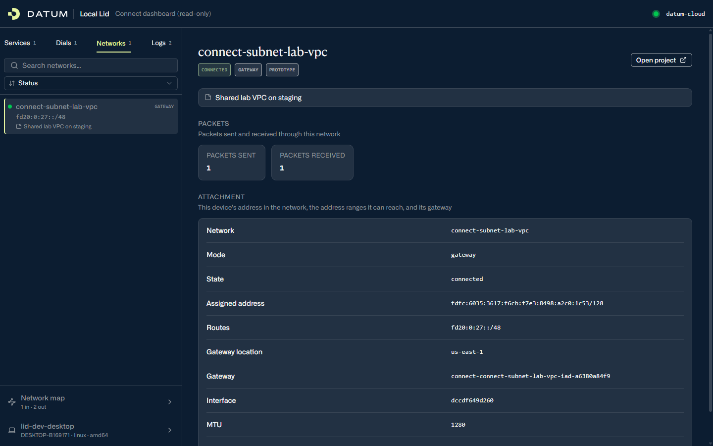
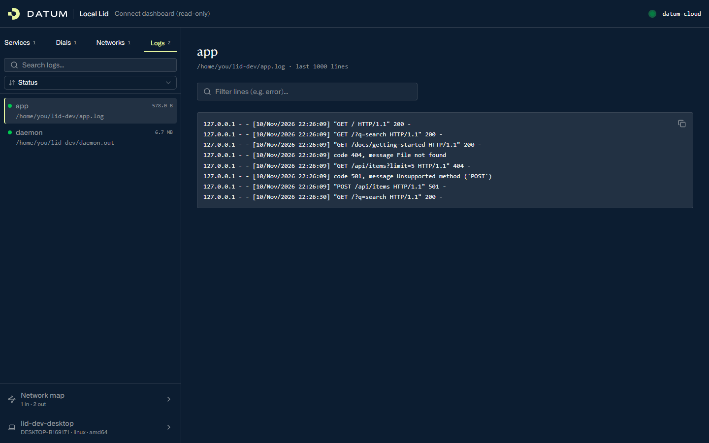
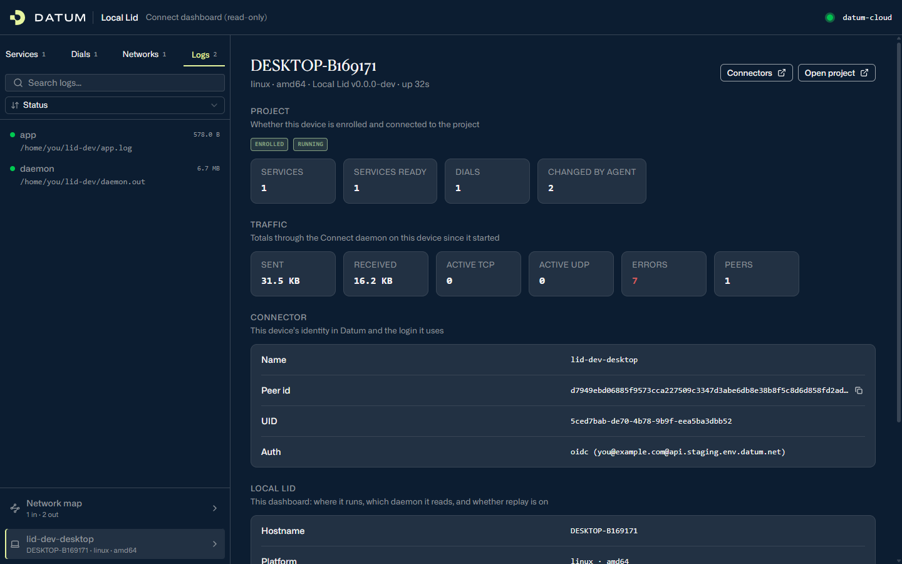

# Local Lid

A local dashboard for **Datum Connect**. It shows what this device shares and reaches, lets you inspect and replay HTTP traffic to your services, and keeps notes and logs next to them.

Local Lid runs next to the Connect daemon (`datum-connectd`) and talks to it only through the daemon's local API. It doesn't change how Connect works: everything it shows comes from the daemon, and everything it changes goes through the daemon's normal API with short-lived tokens.



> **Status: preview.** Built and tested against the Connect daemon on Datum's staging environment. The daemon's API is still changing, so expect breakage when it does.

## What you get

| Where | What it shows |
|---|---|
| **Services** tab | Apps on this device shared with other devices (`datumctl connect serve`) |
| **Dials** tab | Local ports on this device that reach apps on other devices (`datumctl connect dial`), with the connection path (direct or relay) and round-trip time |
| **Networks** tab | VPC networks this device has joined through a Datum gateway (`datumctl connect join`) |
| **Logs** tab | Log files you registered, tailed live, with a filter box |
| **Network map** | Everything above as a live map: what comes in on the left, what goes out on the right |
| **Device** page | Enrollment, traffic totals, this device's connector and peer id |
| **Inspector** | Each HTTP request to a service, with headers and bodies, plus one-click replay |
| **Notes** | A short "why this exists" note on any service, dial or network, shown in lists, detail pages and on the map |

Hover a tab to see what it means. Each section also has a one-line explanation.



## Requirements

- **A running Connect daemon, enrolled in a project.** That's `datumctl connect up` with the Connect plugin. Local Lid reads the daemon's setup token from its state directory, so run Local Lid as the same user as the daemon.
- **To build from source:** Go 1.25+ and [Bun](https://bun.sh) (for the web UI).
- **Platforms:** tested on Linux (including WSL2). It builds on macOS and Windows but hasn't been tested against a daemon there.

## Install

```sh
git clone https://github.com/datum-labs/local-lid.git && cd local-lid
cd web && bun install && bun run build && cd ..
go build -o datumctl-local-lid .
```

To run it as `datumctl local-lid`, put the binary on your `PATH` and trust it once:

```sh
mv datumctl-local-lid ~/.local/bin/          # any directory on your PATH
datumctl plugin trust local-lid
datumctl local-lid version
```

You can also run the binary directly. Every command below works as either `datumctl local-lid …` or `./datumctl-local-lid …`.

## Quick start

```sh
datumctl local-lid init --project <project-id>   # one-time: connect Local Lid to the daemon for this project
datumctl local-lid open                          # serve http://127.0.0.1:47790 and open a browser
```

`init` finds the daemon's setup token (in `$DATUM_CONNECT_DIR` or the default daemon directory; override it with `--setup-token-file`). It creates a read-only **Viewer** token for each project you name. Repeat `--project` for more than one project; the dashboard header then gets a project picker.

Stopping Local Lid (Ctrl+C) is always safe. See [Inspecting HTTP traffic](#inspecting-http-traffic) for what happens to inspected services.

## A quick tour

### Services and the inspector

Each service shows how it's shared, who may connect, and, if it's inspected, every HTTP request that passes through it.



Click a request to see its headers and bodies. Credential headers (`Authorization`, `Cookie` and similar) are stored as `[redacted]`.



**Replay this request** sends it again, straight to the app on this device, and shows the response:



### Dials

A dial is a local port that reaches an app on another device. Local Lid shows whether the connection is **direct** (peer to peer) or going through a **relay**, plus its round-trip time. On the map, a relayed connection turns amber.



### Networks

VPC networks this device has joined: its address in the network, the address ranges it can reach, and the gateway it goes through.



### Logs

Register a log file once with `local-lid logs add`, then watch it live. Only registered files can be read.



### Device

Whether this device is enrolled and connected, traffic totals through the daemon, and this device's identity in Datum.



## Inspecting HTTP traffic

```sh
datumctl local-lid inspect enable 127.0.0.1:8080    # start capturing requests to this service
datumctl local-lid inspect list
datumctl local-lid replay <service-id> <exchange-id> # same as the Replay button
datumctl local-lid inspect disable 127.0.0.1:8080   # put the service back as it was
```

**How it works.** The daemon allows one service per port, and other devices connect to that port, so Local Lid's inspector listens on the **same port at the other loopback address**. For example, `[::1]:8080` sits in front of `127.0.0.1:8080`. Turning it on goes like this:

1. Local Lid starts the inspector first. If the port is taken, it stops there and nothing changes.
2. It records the service's settings.
3. It re-creates the service pointing at the inspector. If anything fails, it rolls back.

Other devices' connections keep working; in testing, the next request after the switch succeeded. The service's id changes each time it's re-created.

**The original service always comes back:**
- on `inspect disable`;
- when Local Lid stops normally;
- on Local Lid's next start, after a crash.

So inspection doesn't survive a restart; run `inspect enable` again.

**Limits:**
- **HTTP over TCP, private services only.** Public and UDP services are refused.
- **The last 200 requests** per service are kept in memory, with bodies up to 64 KiB each. A request whose body was cut short can't be replayed.
- **Replay leaves out redacted credential headers,** so a request that needs a login will usually get a 401 when replayed.
- **Replay can be turned off.** Set `replay_enabled` to `false` in the config: the button disappears and the dashboard can't replay, but the `replay` command still works.

## Notes, logs and audit

```sh
datumctl local-lid note set service 127.0.0.1:8080 "Demo web app on this device"
datumctl local-lid note set dial 18090 "Test page shared by lid-dev-peer"
datumctl local-lid note set network <network-name> "Shared lab VPC"
datumctl local-lid note clear service 127.0.0.1:8080
datumctl local-lid note list

datumctl local-lid logs add app /var/log/app.log
datumctl local-lid logs remove app
datumctl local-lid logs list

datumctl local-lid audit             # what Local Lid has done: inspect, restore, notes, logs, replays
datumctl local-lid audit --daemon    # plus the Connect daemon's own audit log
```

Notes on services are keyed by the service's address (`127.0.0.1:8080`), not its id, so they survive the service being re-created. Dials are identified by their **local** port (the one your app connects to, `18090` above), as the daemon identifies them.

## Command reference

| Command | What it does |
|---|---|
| `init --project <id> [--project …] [--setup-token-file F] [--daemon-url U]` | Connect Local Lid to the daemon; creates a Viewer token per project |
| `serve [--listen 127.0.0.1:47790]` | Run the dashboard (loopback addresses only) |
| `open` | `serve`, and open a browser |
| `inspect enable\|disable <service-id\|address> [--project P]` | Start or stop inspecting a service |
| `inspect list` | Inspected services and how many requests each has captured |
| `replay <service-id> <exchange-id>` | Replay a captured request |
| `note set\|clear service\|dial\|network <selector> [text]`, `note list` | Manage notes. The selector is the service's address or id, the dial's local port, or the network's name |
| `logs add <name> <path>`, `logs remove <name>`, `logs list` | Manage log files the dashboard can show |
| `audit [--daemon] [--project P] [-n N]` | Show the audit log |
| `version` | Print the version |

`inspect`, `replay` and `inspect list` talk to the running `serve`, so start that first.

## Files

Everything lives in one private directory (mode 0700, files 0600):

| OS | Directory |
|---|---|
| Linux | `~/.config/local-lid/` |
| macOS | `~/Library/Application Support/local-lid/` |
| Windows | `%AppData%\local-lid\` |

Set `LOCAL_LID_CONFIG` to use a different config file; the other files live next to it.

| File | Contents |
|---|---|
| `config.json` | Daemon URL, listen address, `replay_enabled`, one Viewer token per project, the setup-token path, and the CLI control secret |
| `inspect.json` | Inspected services and their original settings, so they can always be restored |
| `notes.json`, `logs.json` | Notes and registered log files |
| `audit.jsonl` | Local Lid's audit log |
| `token-names.json` | Ids of short-lived tokens Local Lid created, so the dashboard can label their changes "Local Lid" |

## Security

Local Lid can see your traffic and change your services, so it's built to stay local.

- **Only this machine can reach it.** It listens on a loopback address only, and refuses any request not addressed to `localhost` or a loopback IP. That blocks DNS-rebinding attacks from web pages.
- **The browser never gets a token.** The dashboard is read-only, with one exception: replay, which you can turn off.
- **No long-lived write token.** Each change (inspect on/off, restore) creates an Operate token that lasts 2 minutes, uses it, and revokes it. The daemon's audit log shows each step.
- **CLI-only control.** CLI commands reach the running server through routes that need a secret from the private config. Any request carrying a browser `Origin` header is refused.
- **Credentials aren't stored.** Credential headers are redacted at capture time, so their values never reach memory, disk or the screen.
- **Logs are opt-in.** Only log files you register by name can be read.

## Known limitations

- **No incoming traffic per service.** The Connect daemon reports peers and the path (direct or relay) only for outgoing connections (dials), so a service doesn't show who's connected or how.
- **Public services can't be inspected.** Turning one on can't be verified until the platform supports public services for this daemon.
- **One machine at a time.** Each Local Lid shows its own device; there's no project-wide view yet.
- **Polling, not live updates.** The dashboard polls every 3 seconds.

## Development

```sh
cd web && bun run dev          # UI on Vite, proxying /api to a running `serve` on :47790
cd web && bun run typecheck
go vet ./... && go test ./...  # unit tests for the inspector, local store and Host check
```

| Path | What |
|---|---|
| `main.go` | CLI |
| `internal/connectd` | Client for the Connect daemon's `/v1` API (types mirror the daemon's `model.rs`) |
| `internal/server` | The loopback HTTP server: `/api/*` for the dashboard, `/control/*` for the CLI |
| `internal/inspector` | Inspector: address choice, capture, the swap and restore manager, replay |
| `internal/localstore` | Notes, logs, audit, token names |
| `internal/config` | Config file |
| `web/` | React + [datum-ui](https://www.npmjs.com/package/@datum-cloud/datum-ui) dashboard. Built into one file in `web/dist/`, which is committed because the Go binary embeds it |

